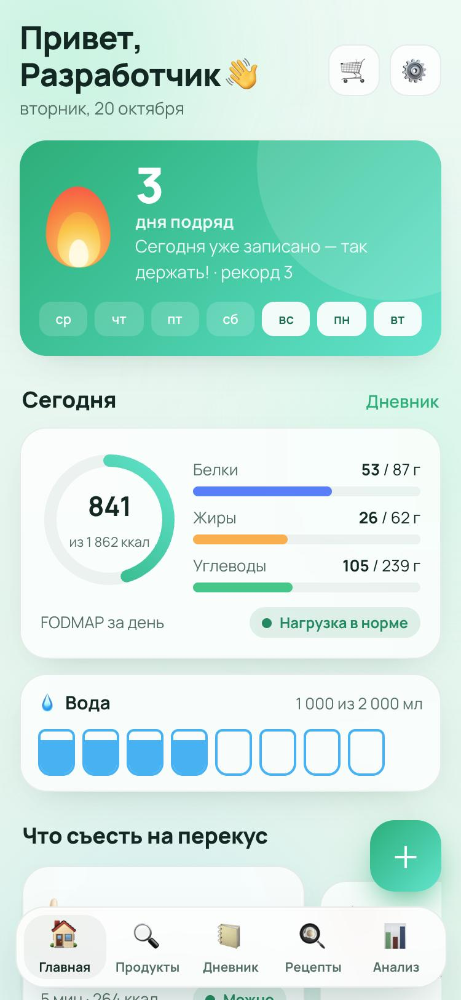
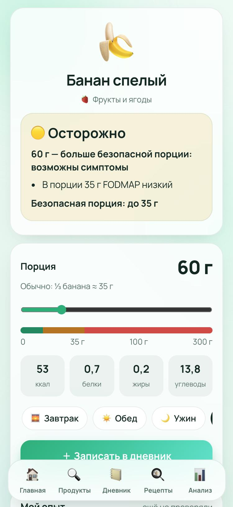
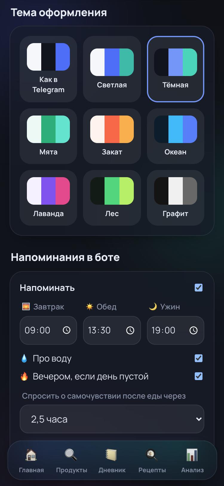

# 🧭 ФудКомпас — Telegram-бот и мини-приложение для low-FODMAP

Помощник для людей с СРК (диета **low-FODMAP**), непереносимостью лактозы и фруктозы, целиакией и пищевой
аллергией. Он подсказывает, **можно ли продукт и в какой порции**, ведёт дневник еды и самочувствия и запоминает,
что подходит **именно вам**.

<p align="center">
  
  
  
</p>

## Что умеет

**Справочник «можно ли?»**
- 320 продуктов с безопасными порциями по данным Monash University и Diet vs Disease: светофор 🟢🟡🔴 меняется
  прямо на ползунке граммов.
- Шесть FODMAP-групп (фруктаны, ГОС, лактоза, избыток фруктозы, сорбит и полиолы, маннит), КБЖУ на 100 г и на
  порцию, аллергены и подсказки, чем заменить.
- Любой товар из магазина: поиск по Open Food Facts и **сканер штрихкода** (камера, фото или цифры). Состав с
  упаковки разбирается автоматически: лук, чеснок, инулин, мёд, сорбит (E420) и т. д.

**Под конкретного человека**
- При первом входе человек отмечает свои ограничения: low-FODMAP, лактоза, фруктоза, полиолы, целиакия,
  12 аллергенов, тип питания (вегетарианство, веганство) и что он не ест.
- **Личная переносимость.** После записи «как я себя чувствую» отметка продукта меняется только у этого человека:
  «💚 подходит мне (до 100 г)», «💛 осторожно» или «❤️‍🩹 не подходит». Если после приёма пищи стало плохо,
  подозреваются только рискованные продукты, а не всё подряд.
- Группы, которые переносятся после этапа повторного введения, можно отключить.

**Дневник**
- Завтрак, обед, ужин, перекус: КБЖУ по формуле Миффлина — Сан Жеора с учётом цели и активности.
- **Накопление FODMAP**: несколько «безопасных» порций за один приём складываются, и бот об этом предупреждает.
- Самочувствие: варианты ответа, 12 симптомов, сила от 0 до 5 и заметка своими словами.
- 🔥 **Огонёк** — сколько дней подряд ведётся дневник, плюс 12 достижений. Ещё учёт воды и список покупок.

**Рецепты и подсказки**
- 30 low-FODMAP рецептов на русском: борщ без лука, плов на чесночном масле, пшённая каша с тыквой и другие. КБЖУ
  и светофор считаются на порцию с учётом ограничений и личных отметок.
- «Что съесть сейчас» на главной: учитывает время суток, оставшиеся калории и то, что вы любите.
- Ингредиенты рецепта можно одной кнопкой добавить в покупки, а для похожих рецептов есть поиск в интернете.

**Анализ и отчёт врачу**
- График самочувствия по дням, подозреваемые продукты-триггеры, FODMAP-группы перед симптомами.
- **PDF-отчёт** за 7–90 дней: бот присылает файл в чат, его можно переслать гастроэнтерологу.

**Бот**
- Можно просто написать «можно ли авокадо?» или прислать фото штрихкода — бот ответит в чате.
- Через 2,5 часа после еды бот спрашивает «как самочувствие?», и на вопрос можно ответить кнопками.
- Напоминания о приёмах пищи и воде, а вечером — «не потеряй огонёк».

**Дизайн**: стеклянные карточки, анимированный огонёк, 9 тем (Как в Telegram, Светлая, Тёмная, Мята, Закат,
Океан, Лаванда, Лес, Графит).

## Стек

- **Python 3.13**: FastAPI (API и раздача мини-приложения), aiogram 3 (бот), SQLite (aiosqlite), httpx,
  fpdf2 (PDF), zxing-cpp (штрихкоды на фото).
- **Мини-приложение**: чистый JS (ES-модули, без сборки), CSS-переменные для тем, Telegram WebApp API.
- Авторизация через подпись `initData` (HMAC-SHA256 токеном бота), все данные привязаны к Telegram ID.
- 75 тестов (pytest), покрытие ~92 %.

```
app/
  api/        маршруты FastAPI, проверка initData, схемы
  bot/        обработчики бота, напоминания, тексты
  services/   FODMAP-логика, каталог, КБЖУ, аналитика, Open Food Facts, PDF
  storage/    репозитории SQLite
data/         foods.psv (каталог продуктов), recipes.json
webapp/       мини-приложение (HTML/CSS/JS)
deploy/       Caddy и systemd-туннель
tests/
```

## Запуск

```bash
python3 -m venv .venv && .venv/bin/pip install -r requirements-dev.txt
cp .env.example .env            # впишите BOT_TOKEN и WEBAPP_URL (https)
.venv/bin/python -m app         # API + мини-приложение на :8000, бот и напоминания
.venv/bin/python -m pytest -q   # тесты
```

Для разработки в браузере без Telegram: `DEV_MODE=1 BOT_TOKEN= .venv/bin/python -m app`, затем откройте
http://localhost:8000.

### Docker

```bash
docker compose up -d --build    # слушает 127.0.0.1:8095, база в ./storage
```

Telegram открывает мини-приложение только по HTTPS. В этом проекте сервис живёт на домашнем сервере за CGNAT,
а наружу выходит через VPS: `deploy/fodmap-tunnel.service` держит обратный SSH-туннель, `deploy/Caddyfile.snippet`
выпускает сертификат и проксирует запросы.

## Данные и ограничения

Порции взяты из открытых таблиц Monash University FODMAP и Diet vs Disease (2018–2024). Где источники расходятся,
выбрано более осторожное значение. Для товаров из Open Food Facts FODMAP оценивается по составу, и это именно
оценка. **ФудКомпас — справочник, а не врач.** Строгая фаза low-FODMAP проводится под наблюдением гастроэнтеролога
или диетолога.

## Лицензия

MIT
